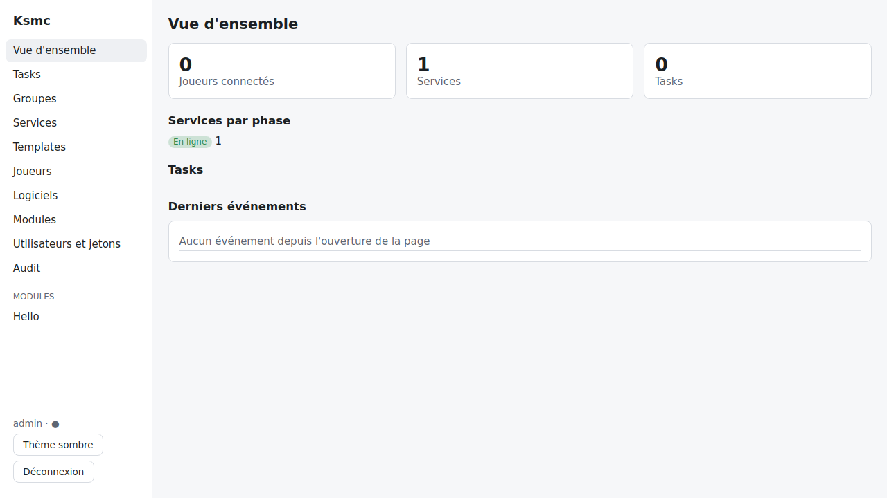
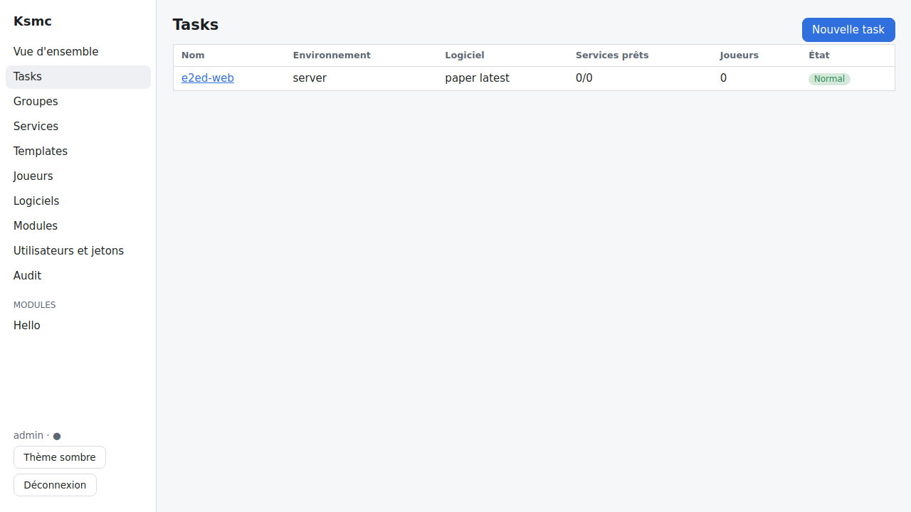
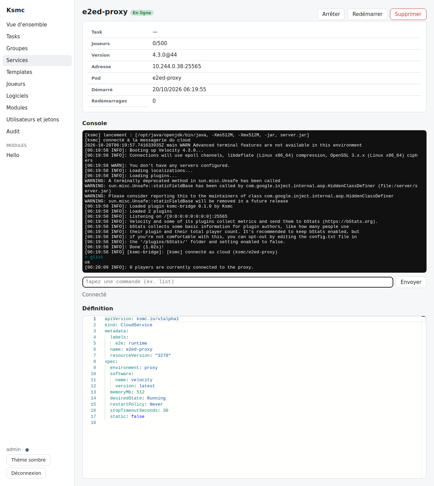
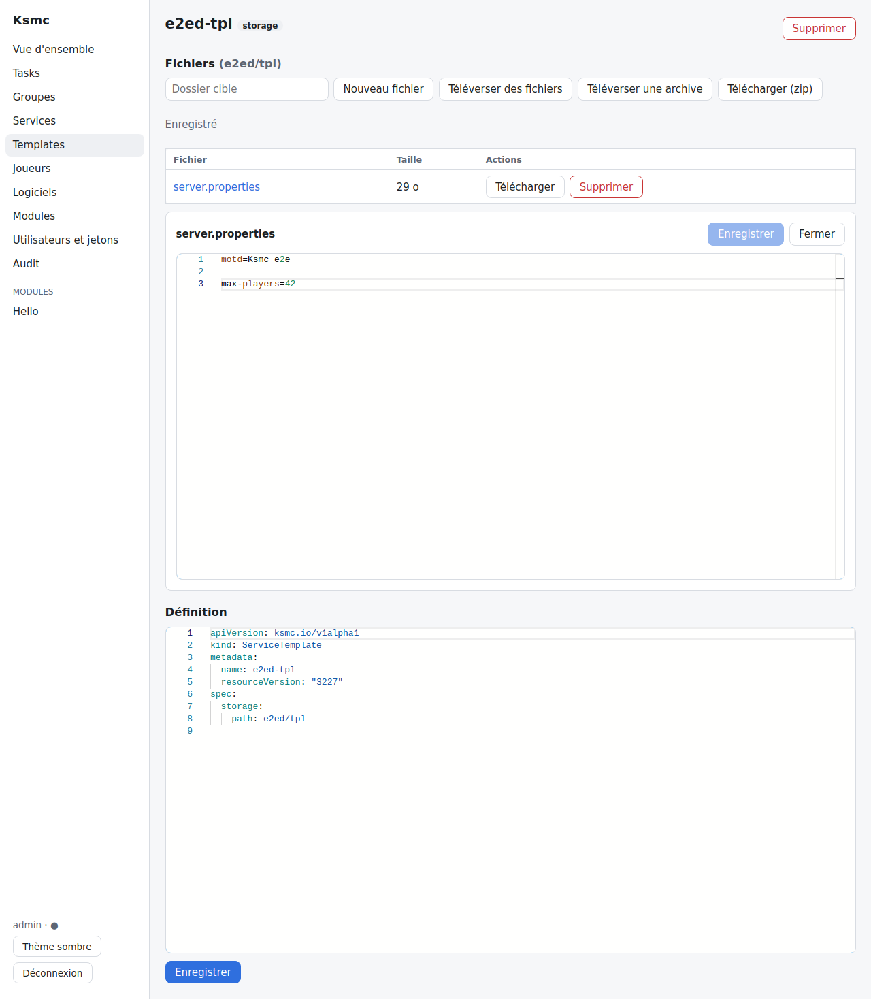
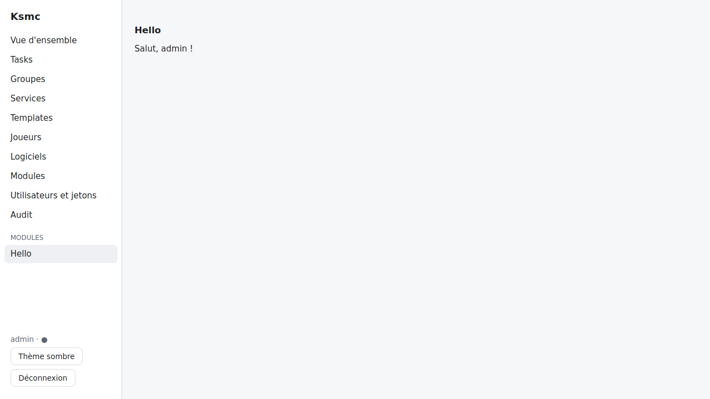
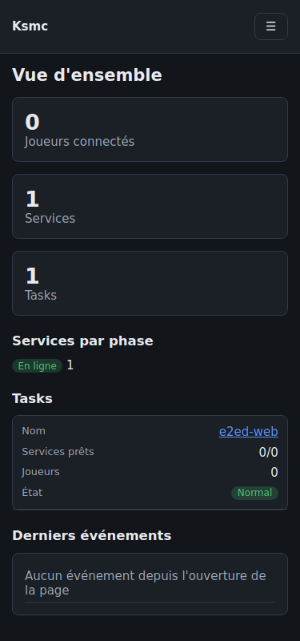
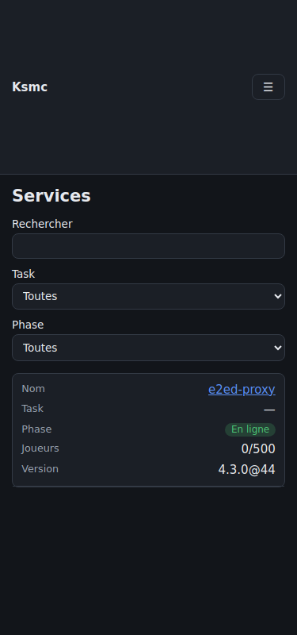

# Dashboard web

Le dashboard gère tout le cloud depuis un navigateur, en temps réel. Il est servi par le controller sur `/` et
utilise l'API REST ([API.md](API.md)) : mêmes comptes, mêmes permissions que la CLI.

> Les captures ci-dessous proviennent du parcours Playwright exécuté dans la CI (job e2e, artefact
> `dashboard-playwright`) sur un cluster kind.

## Accès

```bash
kubectl -n ksmc port-forward svc/ksmc-controller 8080 --address 0.0.0.0
# puis http://localhost:8080 (ou http://<ip-de-la-machine>:8080 depuis le réseau)
```

En production, exposer le service `ksmc-controller` (port 8080) derrière un Ingress HTTPS. Le compte `admin` et son
mot de passe initial sont dans le Secret `ksmc-admin` ; il faut le changer à la première connexion.

La session (jetons d'accès et de renouvellement) est conservée par le navigateur et renouvelée automatiquement.
Les actions que l'utilisateur n'a pas le droit de faire sont masquées ou désactivées (un `viewer` voit les services
mais ne peut ni les arrêter ni taper dans la console).

## Vue d'ensemble

Joueurs connectés, services par phase, état des tasks et derniers événements. Le dashboard garde une connexion
WebSocket au flux d'événements (`/api/v1/events`) : les compteurs et les listes se mettent à jour sans recharger.
Le point à côté du nom d'utilisateur indique l'état de cette connexion.



## Tasks et groupes

Création et modification par **formulaire** (nom, logiciel, version, mémoire, nombre de services, templates,
maintenance) ou en **YAML** complet (éditeur Monaco, validation avant envoi ; les champs que le formulaire ne connaît
pas sont conservés). Depuis la page d'une task : démarrer des services, mettre en maintenance, supprimer.
Les modifications utilisent `If-Match` : un conflit est signalé si la ressource a changé entre-temps.



## Services et console

Liste filtrable (nom, task, phase), détail du service (joueurs, version, adresse, Pod, redémarrages) et actions
(arrêter, démarrer, redémarrer, supprimer). La **console** affiche les 200 dernières lignes puis le direct
(xterm.js) ; avec `ksmc.service.command`, la ligne de saisie envoie des commandes au serveur.



## Templates

Pour les templates `storage` : explorateur de fichiers, édition des fichiers texte (Monaco, coloration selon
l'extension), création, suppression, téléversement de fichiers (dans le dossier cible choisi) ou d'une archive
zip/tar.gz (fusionnée), téléchargement d'un fichier ou du template entier en zip. Les templates git, http, image et
ConfigMap sont affichés en lecture.



## Joueurs, logiciels, modules, administration

- **Joueurs** : liste des joueurs connectés, envoi vers un service, message, expulsion (`ksmc.player.action`).
- **Logiciels** et **modules** : liste, création et édition en YAML ; activation/désactivation et état des modules
  (version chargée, erreur éventuelle).
- **Utilisateurs et jetons** : chacun gère ses jetons d'API (le jeton n'est affiché qu'à la création) ; avec
  `ksmc.account.admin`, création de comptes, rôle, réinitialisation du mot de passe, suppression.
- **Audit** : journal des actions, filtrable par utilisateur, action et cible (`ksmc.audit.read`).

## Pages de modules

Un module peut ajouter une page (`ctx.dashboardPage(...)`, voir [MODULES.md](MODULES.md)) : elle apparaît dans le
menu sous « Modules » dès que le module est actif, sans reconstruire le dashboard. Exemple : le module `hello`.



## Mobile et thème sombre

L'interface reste utilisable à 375 px de large : menu repliable, tableaux affichés en cartes, sans défilement
horizontal. Le thème suit celui du système ; le bouton en bas du menu le force (mémorisé par le navigateur).

<p>
  
  
</p>

## Langues

Tous les textes sont dans `dashboard/src/i18n/locales/fr.json`. Pour une autre langue : copier ce fichier
(ex. `en.json`) et l'ajouter aux `resources` de `dashboard/src/i18n/index.ts`. Un test vérifie que chaque clé
utilisée existe.

## Développement

```bash
cd dashboard
npm ci
KSMC_API=http://localhost:8080 npm run dev   # serveur Vite, API redirigée vers un controller
npm test                                     # tests Vitest
npm run build                                # dist/, embarqué par ./gradlew :ksmc-controller:build
```

Le client typé est généré depuis `ksmc-controller/src/main/resources/api/openapi.json` (`npm run gen:api`).
Les parcours navigateur (`dashboard/e2e`, Playwright) tournent dans le job e2e de la CI via `DashboardE2eTest`.
